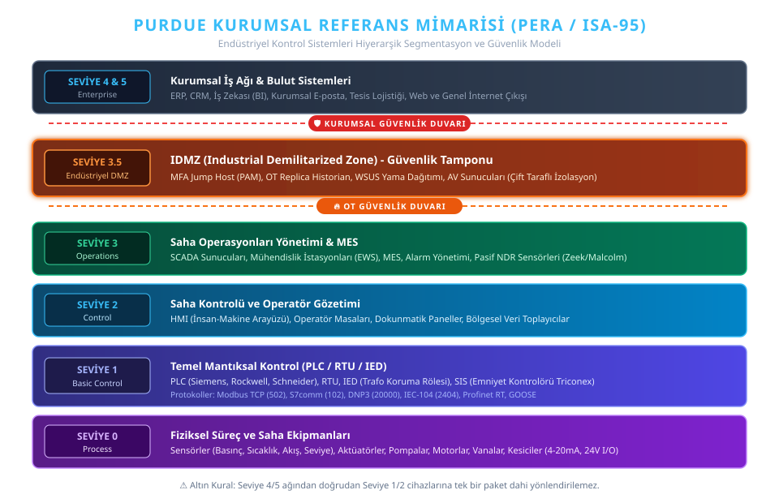
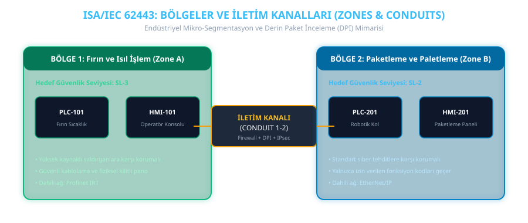
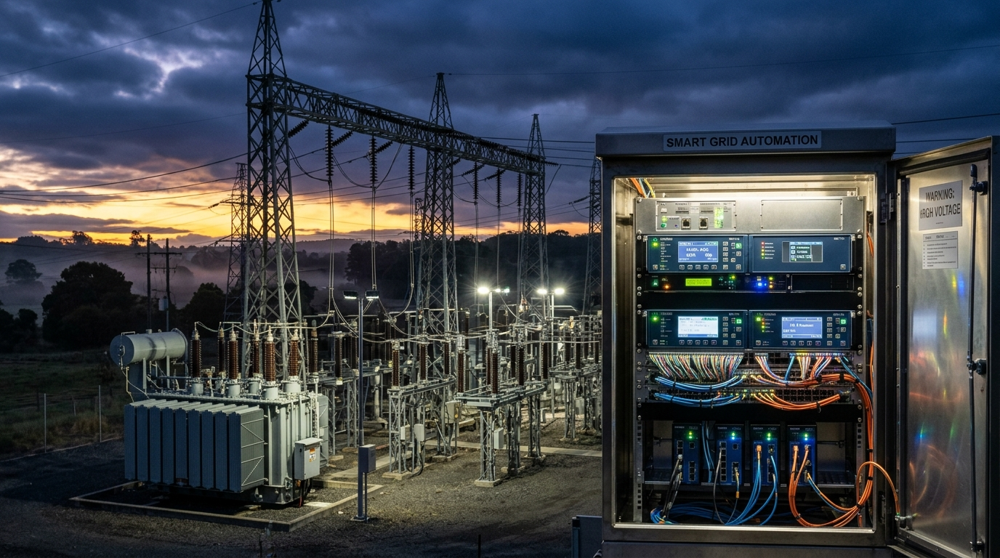
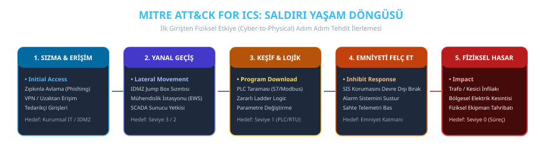
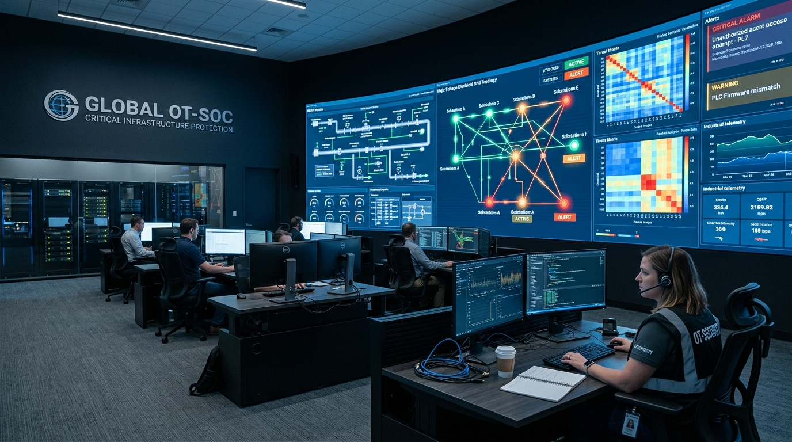
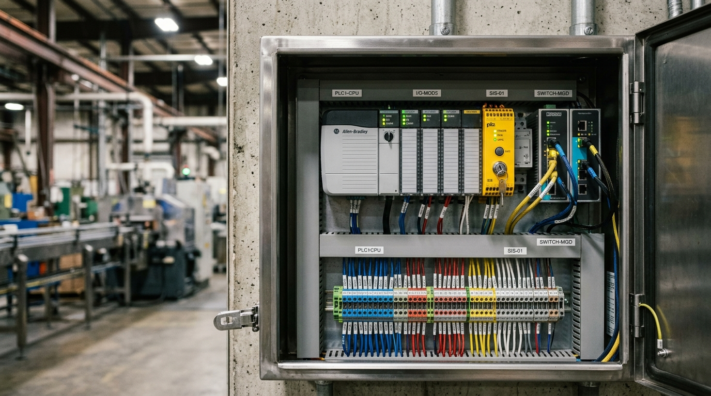
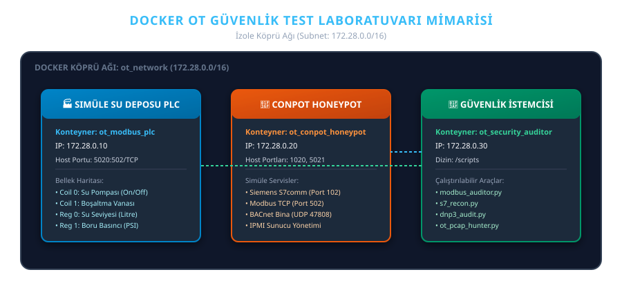

# Operasyonel Teknolojiler (OT) & Endüstriyel Kontrol Sistemleri (ICS) Güvenliği: Kapsamlı Başvuru, Tehdit Analizi ve Savunma Rehberi


[](https://awesome.re)
[](LICENSE)
[](CONTRIBUTING.md)
[](https://www.isa.org/standards-and-publications/isa-standards/isa-standards-committees/isa62443)
[](#)
[](labs/README.md)
[](scripts/README.md)

Operasyonel Teknolojiler (OT), Endüstriyel Kontrol Sistemleri (ICS), SCADA, Dağıtık Kontrol Sistemleri (DCS), PLC/RTU donanımları ve Kritik Altyapıların siber güvenliği üzerine hazırlanmış; temel mimarilerden derinlemesine protokol analizlerine, geçmiş siber felaketlerden savunma stratejilerine, **çalıştırılabilir Docker laboratuvarından pratik Python denetim ve tehdit avcılığı araçlarına** kadar uzanan **dünya standartlarında, kapsamlı Türkçe başvuru kaynağı ve cephaneliğidir.**

---

## 🗺️ Depo Ekosistemi ve Modül Haritası

Bu repo yalnızca teorik bir doküman değil; aynı zamanda çalışan laboratuvarlar, pratik araçlar ve hile tabloları içeren tam teşekküllü bir ekosistemdir:

```text
awesome-ot-security/
├── 🧪 labs/                           -> İnteraktif Docker Test Laboratuvarı
│   ├── docker-compose.yml             -> PLC, Honeypot ve Auditor konteyner mimarisi
│   ├── modbus-sim/                    -> Simüle Edilmiş Su Deposu Süreç PLC'si (Python/PyModbus)
│   ├── ids-sensor/rules/              -> Suricata / Snort Endüstriyel Tehdit Tespit Kuralları
│   └── README.md                      -> Adım adım lab kurulum ve test kılavuzu
│
├── 🛠️ scripts/                        -> Python Tabanlı OT Güvenlik Araç Kiti
│   ├── modbus_auditor.py              -> Modbus TCP keşif, bellek dökümü ve yetkisiz yazma denetleyicisi
│   ├── s7_recon.py                    -> Siemens S7-300/400/1200/1500 donanım ve CPU durum tarayıcısı
│   ├── goose_analyzer.py              -> IEC 61850 GOOSE L2 çerçeve analizörü & Replay dedektörü
│   ├── dnp3_audit.py                  -> DNP3 (IEEE 1815) Outstation bağlantı durumu ve güvenlik denetimi
│   ├── ot_pcap_hunter.py              -> Çevrimdışı PCAP tehdit avcısı (Modbus yazma, S7 CPU STOP tespiti)
│   ├── requirements.txt               -> Gerekli Python bağımlılıkları
│   └── README.md                      -> Araç çalıştırma kılavuzu ve parametreler
│
├── 📑 cheatsheets/                    -> Hızlı Başvuru ve Hile Tabloları
│   ├── wireshark_ot_filters.md        -> Wireshark endüstriyel filtreleri ve anomali tespiti
│   └── top20_plc_coding_tr.md         -> Top 20 Güvenli PLC Kodlama İlkeleri (Türkçe Rehber)
│
├── 🏛️ frameworks/                     -> Mimari ve Tehdit Çerçeveleri
│   ├── purdue_reference.md            -> Purdue (ISA-95) Modeli ve Katı Segmentasyon İlkeleri
│   └── mitre_attack_ics_deepdive.md   -> MITRE ATT&CK for ICS Tehdit ve Savunma Matrisi
│
├── CONTRIBUTING.md                    -> Katkıda bulunma rehberi
├── LICENSE                            -> MIT Lisansı
└── README.md                          -> Ana başvuru dokümanı
```

---

## ⚡ Hızlı Başlangıç (Quickstart)

### 1. Docker Laboratuvarını Ayağa Kaldırma (Simüle PLC & Honeypot)
```bash
cd labs
docker compose up -d
docker logs -f ot_modbus_plc
```

### 2. Modbus Denetim Aracını Çalıştırma
```bash
cd scripts
pip install -r requirements.txt

# Simüle edilmiş su deposu PLC'sini tara ve yetkisiz yazma testi yap
python modbus_auditor.py -t 127.0.0.1 -p 5020 --test-write
```

---

## 📑 İçindekiler

1. [Temel Doktrin: IT ve OT Arasındaki Felsefi ve Mimari Ayrım](#1-temel-doktrin-it-ve-ot-arasındaki-felsefi-ve-mimari-ayrım)
   - [Öncelik Paradigması: C-I-A vs S-R-A-I-C](#öncelik-paradigması-c-i-a-vs-s-r-a-i-c)
   - [Siber-Fiziksel Sistemler (CPS) ve Fonksiyonel Güvenlik (Safety)](#siber-fiziksel-sistemler-cps-ve-fonksiyonel-güvenlik-safety)
   - [Kapsamlı IT vs OT Karşılaştırma Matrisi](#kapsamlı-it-vs-ot-karşılaştırma-matrisi)
2. [Endüstriyel Mimari ve Segmentasyon Modelleri](#2-endüstriyel-mimari-ve-segmentasyon-modelleri)
   - [Purdue Kurumsal Referans Mimarisi (PERA / ISA-95)](#purdue-kurumsal-referans-mimarisi-pera--isa-95)
   - [Endüstriyel DMZ (IDMZ - Seviye 3.5) Rolü ve Katı Trafik Kuralları](#endüstriyel-dmz-idmz---seviye-35-rolü-ve-katı-trafik-kuralları)
   - [ISA/IEC 62443 Zones and Conduits Modeli](#isaiec-62443-zones-and-conduits-modeli)
   - [Modern Trendler: OT Sıfır Güven (Zero Trust), SASE ve Veri Diyotları](#modern-trendler-ot-sıfır-güven-zero-trust-sase-ve-veri-diyotları)
3. [Endüstriyel Protokoller ve Zafiyet Analizleri](#3-endüstriyel-protokoller-ve-zafiyet-analizleri)
   - [Modbus TCP & RTU (Port 502)](#modbus-tcp--rtu-port-502)
   - [DNP3 & DNP3-SAv5 (Port 20000)](#dnp3--dnp3-sav5-port-20000)
   - [OPC Classic vs OPC UA (Port 4840)](#opc-classic-vs-opc-ua-port-4840)
   - [Siemens S7comm & S7comm-plus (Port 102)](#siemens-s7comm--s7comm-plus-port-102)
   - [EtherNet/IP & CIP (Port 44818 / 2222)](#ethernetip--cip-port-44818--2222)
   - [Profinet & Profibus](#profinet--profibus)
   - [IEC 60870-5-104 (Port 2404) & IEC 60870-5-101](#iec-60870-5-104-port-2404--iec-60870-5-101)
   - [IEC 61850 Trafo Mimarisi (GOOSE, SV, MMS) & IEC 62351](#iec-61850-trafo-mimarisi-goose-sv-mms--iec-62351)
   - [BACnet / IP & BACnet Secure Connect (Port 47808)](#bacnet--ip--bacnet-secure-connect-port-47808)
   - [IIoT Protokolleri: MQTT, CoAP, Sparkplug B](#iiot-protokolleri-mqtt-coap-sparkplug-b)
   - [Protokol Güvenlik ve Karşılaştırma Matrisi](#protokol-güvenlik-ve-karşılaştırma-matrisi)
4. [MITRE ATT&CK for ICS (Endüstriyel Tehdit Matrisi)](#4-mitre-attck-for-ics-endüstriyel-tehdit-matrisi)
   - [Saldırı Taktikleri ve Matris Yapısı](#saldırı-taktikleri-ve-matris-yapısı)
   - [Kritik ICS Teknikleri ve Karşılıkları](#kritik-ics-teknikleri-ve-karşılıkları)
5. [Tarihe Geçen Kritik OT & Altyapı Siber Saldırıları (Vaka İncelemeleri)](#5-tarihe-geçen-kritik-ot--altyapı-siber-saldırıları-vaka-incelemeleri)
   - [1. Stuxnet (2010 - İran Nükleer Tesisleri)](#1-stuxnet-2010---iran-nükleer-tesisleri)
   - [2. Alman Çelik Fabrikası Olayı (2014)](#2-alman-çelik-fabrikası-olayı-2014)
   - [3. BlackEnergy 3 & Sandworm (2015 - Ukrayna Enerji Şebekesi)](#3-blackenergy-3--sandworm-2015---ukrayna-enerji-şebekesi)
   - [4. Industroyer / Crashoverride (2016 - Kiev Trafo Saldırısı)](#4-industroyer--crashoverride-2016---kiev-trafo-saldırısı)
   - [5. TRITON / TRISIS / HatMan (2017 - Petrokimya SIS Hedeflemesi)](#5-triton--trisis--hatman-2017---petrokimya-sis-hedeflemesi)
   - [6. Colonial Pipeline (2021 - Fidye Yazılımı ve Lojistik Kriz)](#6-colonial-pipeline-2021---fidye-yazılımı-ve-lojistik-kriz)
   - [7. Oldsmar Su Arıtma Tesisi (2021 - Kimyasal Denge Manipülasyonu)](#7-oldsmar-su-arıtma-tesisi-2021---kimyasal-denge-manipülasyonu)
   - [8. Industroyer2 & CaddyWiper (2022 - Ukrayna Yüksek Gerilim Saldırısı)](#8-industroyer2--caddywiper-2022---ukrayna-yüksek-gerilim-saldırısı)
   - [9. INCONTROLLER / PIPEDREAM (2022 - Modüler ICS Siber Silah Kiti)](#9-incontroller--pipedream-2022---modüler-ics-siber-silah-kiti)
   - [10. Unitronics PLC & Su Altyapısı Kampanyaları (2023-2024)](#10-unitronics-plc--su-altyapısı-kampanyaları-2023-2024)
6. [Güvenlik Standartları, Yönetmelikler ve Uyumluluk](#6-güvenlik-standartları-yönetmelikler-ve-uyumluluk)
   - [ISA/IEC 62443 Serisi (Tüm Katmanlar ve SL1-SL4)](#isaiec-62443-serisi-tüm-katmanlar-ve-sl1-sl4)
   - [NIST SP 800-82 Rev 3 (ICS Güvenlik Rehberi)](#nist-sp-800-82-rev-3-ics-güvenlik-rehberi)
   - [NERC CIP Standartları (Kritik Elektrik Altyapıları)](#nerc-cip-standartları-kritik-elektrik-altyapıları)
   - [AB NIS 2 Direktifi ve Kritik Sektör Yükümlülükleri](#ab-nis-2-direktifi-ve-kritik-sektör-yükümlülükleri)
   - [T.C. Cumhurbaşkanlığı Dijital Dönüşüm Ofisi BİGR (Endüstriyel Kontrol Sistemleri)](#tc-cumhurbaşkanlığı-dijital-dönüşüm-ofisi-bigr-endüstriyel-kontrol-sistemleri)
7. [Savunma Stratejileri, Ağ Görünürlüğü ve Mavi Takım (Blue Team)](#7-savunma-stratejileri-ağ-görünürlüğü-ve-mavi-takım-blue-team)
   - [Derinlemesine Savunma (Defense-in-Depth for OT)](#derinlemesine-savunma-defense-in-depth-for-ot)
   - [Pasif Ağ Dinleme vs Aktif Ağ Taraması Tehlikeleri](#pasif-ağ-dinleme-vs-aktif-ağ-taraması-tehlikeleri)
   - [Endüstriyel Tehdit Avcılığı, Ağ Tespiti (NDR) ve SIEM](#endüstriyel-tehdit-avcılığı-ağ-tespiti-ndr-ve-siem)
   - [Güvenli Uzaktan Erişim (SRA) ve Kimlik Doğrulama Mimarisi](#güvenli-uzaktan-erişim-sra-ve-kimlik-doğrulama-mimarisi)
   - [ICS Olay Müdahalesi (Incident Response) ve Adli Bilişim (DFIR)](#ics-olay-müdahalesi-incident-response-ve-adli-bilişim-dfir)
8. [PLC Güvenliği, Güvenli Kodlama ve Donanım Analizi](#8-plc-güvenliği-güvenli-kodlama-ve-donanım-analizi)
   - [Top 20 Güvenli PLC Kodlama İlkeleri (Top 20 Secure PLC Coding)](#top-20-güvenli-plc-kodlama-ilkeleri-top-20-secure-plc-coding)
   - [PLC Donanım ve Firmware Güvenliği](#plc-donanım-ve-firmware-güvenliği)
9. [Uygulamalı Laboratuvar, Simülatörler ve Honeypotlar](#9-uygulamalı-laboratuvar-simülatörler-ve-honeypotlar)
   - [Açık Kaynak Simülatörler ve Sanal Test Sahaları](#açık-kaynak-simülatörler-ve-sanal-test-sahaları)
   - [Endüstriyel Honeypotlar](#endüstriyel-honeypotlar)
   - [Eğitim ve Analiz İçin Açık PCAP Depoları](#eğitim-ve-analiz-için-açık-pcap-depoları)
10. [Endüstriyel Güvenlik Cephaneliği ve Araçlar (Awesome Arsenal)](#10-endüstriyel-güvenlik-cephaneliği-ve-araçlar-awesome-arsenal)
    - [Keşif ve Varlık Envanteri](#keşif-ve-varlık-envanteri)
    - [Protokol Test ve Denetim Araçları](#protokol-test-ve-denetim-araçları)
    - [Trafik Analizi ve Protokol Ayrıştırıcılar](#trafik-analizi-ve-protokol-ayrıştırıcılar)
    - [Güvenlik Açığı Değerlendirme ve Exploit Framework'leri](#güvenlik-açığı-değerlendirme-ve-exploit-frameworkleri)
11. [Wireshark Endüstriyel Protokol Filtreleri & Cheat Sheet](#11-wireshark-endüstriyel-protokol-filtreleri--cheat-sheet)
12. [Pratik Kod Örnekleri (Python Betikleri)](#12-pratik-kod-örnekleri-python-betikleri)
    - [12.1 Modbus TCP Denetim ve Manipülasyon Test Betiği](#121-modbus-tcp-denetim-ve-manipülasyon-test-betiği)
    - [12.2 S7comm Siemens PLC Bilgi Toplama ve CPU Durumu Sorgulama](#122-s7comm-siemens-plc-bilgi-toplama-ve-cpu-durumu-sorgulama)
    - [12.3 IEC 61850 GOOSE Trafiği Pasif Dinleme ve Anomali Tespiti](#123-iec-61850-goose-trafiği-pasif-dinleme-ve-anomali-tespiti)
13. [Sertifikasyonlar, Kariyer Yolu ve Eğitim Kaynakları](#13-sertifikasyonlar-kariyer-yolu-ve-eğitim-kaynakları)
    - [Uluslararası Sertifikasyonlar](#uluslararası-sertifikasyonlar)
    - [Temel Kitaplar ve Başvuru Eserleri](#temel-kitaplar-ve-başvuru-eserleri)
    - [Topluluklar, Konferanslar ve CTF Platformları](#topluluklar-konferanslar-ve-ctf-platformları)
14. [Katkıda Bulunma, Lisans ve Yasal Uyarı](#14-katkıda-bulunma-lisans-ve-yasal-uyarı)

---

## 1. Temel Doktrin: IT ve OT Arasındaki Felsefi ve Mimari Ayrım

Endüstriyel sahalarda yazılım hataları veya siber saldırılar yalnızca ekranda hata penceresi açmakla kalmaz; vanaların aşırı basınçla patlamasına, yüksek gerilim trafolarının infilak etmesine, kimyasal reaktörlerin kontrolden çıkmasına veya can kayıplarına neden olabilir.

> "Tipik bir kurumsal IT ortamında güvenlik çemberi kırıldığında veri sızar ya da sistem kilitlenir; OT ortamında güvenlik çemberi kırıldığında ise tesis yanabilir, çevre zehirlenebilir veya insanlar hayatını kaybedebilir. Buradaki temel varlık 'veri' değil, 'fiziksel süreç' ve 'can emniyeti'dir."
> — **NIST SP 800-82 Rev 3, Guide to Operational Technology (OT) Security**

### Öncelik Paradigması: C-I-A vs S-R-A-I-C

* **Kurumsal IT (C-I-A):**
  1. **Confidentiality (Gizlilik):** Müşteri verileri, ticari sırlar ve finansal kayıtlar izinsiz erişimden korunmalıdır.
  2. **Integrity (Bütünlük):** Verinin manipüle edilmemesi garanti altına alınmalıdır.
  3. **Availability (Erişilebilirlik):** Sistemler iş saatlerinde açık olmalıdır; saatlik veya gecelik bakım kesintileri genellikle tolere edilebilir.

* **Operasyonel Teknolojiler (S-R-A-I-C):**
  1. **Safety (Can ve Çevre Emniyeti):** İnsan hayatı, işçi sağlığı, kamu güvenliği ve çevresel koruma her şeyin üzerindedir.
  2. **Reliability (Güvenilirlik):** Süreç deterministik olmalı, öngörülebilir toleranslar dahilinde kesintisiz çalışmalıdır.
  3. **Availability (Erişilebilirlik / Çalışma Süresi):** %99.999 ("beş dokuz") kesintisiz çalışma. Plansız 1 saniyelik bir duruş bile milyonlarca dolarlık hurda üretime veya tehlikeli kimyasal reaksiyonlara yol açabilir.
  4. **Integrity (Süreç Bütünlüğü):** Sensör ölçümleri ve aktüatör komutları tahrif edilmemelidir.
  5. **Confidentiality (Gizlilik):** Genellikle en son sıradadır. Bir vananın açık/kapalı durumu sır değildir; fakat o vananın açık kalması patlamayı engeller.

### Siber-Fiziksel Sistemler (CPS) ve Fonksiyonel Güvenlik (Safety)

Endüstriyel kontrol sistemleri **Siber-Fiziksel Sistemlerdir (Cyber-Physical Systems - CPS)**. Yani siber uzaydaki bitler doğrudan termodinamik, kimyasal ve mekanik süreçleri kontrol eder.
* **Fonksiyonel Güvenlik (Functional Safety - IEC 61508 / IEC 61511):** Sistem bileşenlerinin rastgele donanım arızalarında tesisi güvenli duruma (Fail-Safe) geçirmesini sağlar.
* **Siber Güvenlik (Security) ile Kesişim:** Geleneksel güvenlik analistleri "cihaz bozulursa ne olur?" sorusuna yanıt ararken; OT siber güvenlik uzmanları *"Bir saldırgan emniyet sistemini (SIS) bilinçli olarak devreden çıkarıp süreci aşırı basınca zorlarsa ne olur?"* sorusunu yanıtlar.

### Kapsamlı IT vs OT Karşılaştırma Matrisi

| Özellik / Metrik | Bilgi Teknolojileri (IT) | Operasyonel Teknolojiler (OT / ICS) |
| :--- | :--- | :--- |
| **Öncelik Sıralaması** | Gizlilik > Bütünlük > Erişilebilirlik | Emniyet (Safety) > Güvenilirlik > Erişilebilirlik > Bütünlük > Gizlilik |
| **Gecikme Toleransı (Latency)** | Saniyeler veya dakikalar tolere edilir. | Mikrosaniyeler ile milisaniyeler (Deterministik gerçek zamanlı). |
| **Sistem Yaşam Döngüsü** | 3 – 5 yıl (Donanım/OS hızla güncellenir). | 15 – 35 yıl (Değişmeyen legacy PLC, RTU ve gömülü donanımlar). |
| **Yama Yönetimi (Patching)** | Düzenli, otomatik, haftalık/aylık yama döngüleri. | Yılda 1-2 kez planlı duruşlarda (Turnaround); "hot-patching" kabul edilemez. |
| **İşletim Sistemleri** | Windows 11/Server, Linux, macOS (Modern sürümler). | VxWorks, QNX, FreeRTOS, Windows NT/XP/7 Embedded, gömülü firmware. |
| **Ağ Protokolleri** | Standart TCP/IP, HTTPS, DNS, SSH, TLS 1.3. | Modbus, DNP3, Profinet, IEC 104, S7comm, GOOSE (Genellikle şifresiz/açık). |
| **Aktif Tarama Toleransı** | Ağ tarayıcıları (Nmap, Nessus) rutin çalıştırılır. | Aktif port/zafiyet taramaları eski PLC'leri kilitleyebilir (DoS riski). |
| **Etki Alanı (Impact)** | Veri hırsızlığı, finansal kayıp, itibar zararı. | Fiziksel ekipman tahribatı, patlama, çevre kirliliği, can kaybı. |
| **Yedeklilik (Redundancy)** | Veri merkezleri, cloud yedekleme, failover cluster. | Çift hatlı hot-standby PLC'ler, 1oo2/2oo3 Safety Logic mimarileri. |

---

## 2. Endüstriyel Mimari ve Segmentasyon Modelleri

> 📖 *Ayrıntılı referans mimari dokümanı için:* [frameworks/purdue_reference.md](frameworks/purdue_reference.md)

### Purdue Kurumsal Referans Mimarisi (PERA / ISA-95)



Purdue Modeli, bir üretim tesisindeki bilgi akışını ve operasyonel hiyerarşiyi Seviye 0'dan Seviye 5'e kadar disipline eden endüstri standardı mimaridir:

```text
+-----------------------------------------------------------------------------------+
| SEVİYE 5: Kurumsal Ağ (Enterprise Network)                                         |
| -> ERP, İş Zekası (BI), Dış Tedarik Zinciri Entegrasyonları, Bulut Platformları     |
+-----------------------------------------------------------------------------------+
| SEVİYE 4: İş Yolu ve Tesis Lojistiği (Business Logistics)                         |
| -> Kurumsal E-posta, Tesis İçi Dosya Paylaşımı, Mühendislik İstemcileri, İK        |
+===================================================================================+
| SEVİYE 3.5: Endüstriyel DMZ (IDMZ - Industrial Demilitarized Zone)                |
| -> Jump Box (Güvenli Atlama Sunucusu), Yama Yönetimi (WSUS), OT Tarihçi (Historian)|
| -> Antivirüs Dağıtımı, Çift Taraflı Güvenlik Duvarı İzolasyonu                    |
+===================================================================================+
| SEVİYE 3: Saha Operasyonları Yönetimi (Site Operations / MES)                     |
| -> İmalat Yürütme Sistemleri (MES), SCADA Sunucuları, Mühendislik İstasyonları    |
| -> Saha Raporlama Veritabanları, Alarm Yönetim Sunucuları                         |
+-----------------------------------------------------------------------------------+
| SEVİYE 2: Alan Kontrolü ve Operatör Gözetimi (Supervisory Control)                |
| -> HMI (Human-Machine Interface), Operatör Konsolları, Alarm Panelleri           |
+-----------------------------------------------------------------------------------+
| SEVİYE 1: Temel Kontrol (Basic Control Layer)                                     |
| -> PLC (Programlanabilir Mantıksal Denetleyici), RTU (Uzak Uç Birimi)             |
| -> IED (Akıllı Elektronik Cihaz), SIS (Emniyet Enstrümanlı Sistem Kontrolörü)     |
+-----------------------------------------------------------------------------------+
| SEVİYE 0: Fiziksel Süreç (Process Layer)                                          |
| -> Sensörler (Basınç, Sıcaklık, Seviye), Aktüatörler, Vanalar, Pompalar, Şalt      |
| -> 4-20mA Analog Sinyaller, Hart, IO-Link, 24V Dijital Girdi/Çıktılar            |
+-----------------------------------------------------------------------------------+
```

### Endüstriyel DMZ (IDMZ - Seviye 3.5) Rolü ve Katı Trafik Kuralları

Endüstriyel DMZ, Kurumsal Ağ (IT - Seviye 4/5) ile Üretim Ağı (OT - Seviye 3 ve altı) arasındaki en kritik güvenlik bariyeridir.

1. **Doğrudan Geçiş Yasağı (No Direct Routing):** Seviye 4'ten doğrudan Seviye 3, 2 veya 1'e giden tek bir paket bile yönlendirilemez. Bütün trafik IDMZ'de sonlanmalıdır (Terminated at IDMZ).
2. **Çift Protokol Ayrımı (Protocol Break):** Doğrudan veritabanı bağlantısı kurulamaz. Veri akışı için Seviye 3'teki "OT Historian", verilerini Seviye 3.5'teki "Enterprise Replica Historian"a kopyalar; kurumsal istemciler yalnızca Seviye 3.5'teki kopyayı sorgular.
3. **MFA ile Jump Host Zorunluluğu:** Mühendislerin saha operasyonlarına erişimi yalnızca Seviye 3.5 üzerinde konumlandırılan ve Çok Faktörlü Kimlik Doğrulama (MFA) ile korunan Jump Server (PAM) üzerinden sağlanmalıdır.
4. **Farklı Active Directory Ormanları:** Kurumsal IT Active Directory alanı ile OT ortamı asla aynı Domain Controller'ı paylaşmamalıdır. OT için izole bir AD ormanı kurulmalı veya güven ilişkisi (Trust Relationship) bulunmamalıdır.

### ISA/IEC 62443 Zones and Conduits Modeli



Geleneksel çevre güvenliğinin yetersizliğini gören ISA/IEC 62443, ağın mikro-segmentasyonunu zorunlu kılar:

```text
[ BÖLGE 1: Fırın Kontrolü ]                      [ BÖLGE 2: Paketleme Hattı ]
  (Hedef SL: 3)                                    (Hedef SL: 2)
  +----------------------+                         +----------------------+
  | PLC-101 | HMI-101    |                         | PLC-201 | HMI-201    |
  +----------+-----------+                         +----------+-----------+
             |                                                |
             +======= İLETİM KANALI (CONDUIT: FW/IPsec) ======+
                             (Deep Packet Inspection)
```

* **Zone (Bölge):** Benzer güvenlik risklerine ve operasyonel işlevlere sahip varlıkların mantıksal veya fiziksel olarak gruplanmasıdır.
* **Conduit (İletim Kanalı):** Bölgeler arası iletişimi sağlayan, üzerinde sıkı denetim (DPI - Derin Paket İncelemesi, IPS, Firewall) uygulanan kontrollü iletişim borularıdır. İzinsiz iletişimler engellenir.

### Modern Trendler: OT Sıfır Güven (Zero Trust), SASE ve Veri Diyotları

* **Veri Diyotları (Data Diodes):** Fiziksel düzeyde (LED ve fotodiyot kullanarak) bilginin yalnızca tek yönde (örneğin OT'den IT'ye) akmasını garanti eden donanımlardır. Fiziksel olarak ters yönde ışık iletilemeyeceği için dış dünyadan OT ağına paket göndermek imkansızdır.
* **OT Sıfır Güven (Zero Trust Architecture):** "Asla güvenme, her zaman doğrula." Cihazların kimlikleri kriptografik olarak doğrulanır, oturumlar mikro-segmentasyonla sınırlandırılır ve protokol bazlı anomali kontrolleri yapılır.
* **Güvenli Uzaktan Erişim (Secure Remote Access - SRA):** Standart VPN çözümleri tüm ağa erişim yetkisi verdiği için OT için büyük risktir. Bunun yerine yalnızca tek bir porta/protokole izin veren oturum kayıtlı ZTNA/SRA çözümleri tercih edilir.

---

## 3. Endüstriyel Protokoller ve Zafiyet Analizleri

Geleneksel endüstriyel protokoller 1970-1990 yılları arasında, sahaların tamamen hava boşluğuyla (air-gap) izole olduğu varsayımıyla geliştirilmiştir. Bu nedenle varsayılan olarak **şifreleme (encryption)**, **kimlik doğrulama (authentication)** ve **bütünlük kontrolü (integrity check)** içermezler.

### Modbus TCP & RTU (Port 502)

1979 yılında Modicon (Schneider Electric) tarafından geliştirilen en yaygın açık kaynak endüstriyel protokoldür.
* **Çalışma Prensibi:** İstemci/Sunucu (Master/Slave) mimarisi. Veriler Coils (1-bit yazılabilir/okunabilir), Discrete Inputs (1-bit sadece okunabilir), Input Registers (16-bit sadece okunabilir) ve Holding Registers (16-bit okunabilir/yazılabilir) tablolarında tutulur.
* **Kritik Fonksiyon Kodları:**
  - `0x01` (Read Coils), `0x03` (Read Holding Registers)
  - `0x05` (Write Single Coil), `0x06` (Write Single Register)
  - `0x0F` (Write Multiple Coils), `0x10` (Write Multiple Registers)
* **Zafiyetler:** Şifreleme ve doğrulama yoktur. Ağa giren herhangi bir cihaz `Write Single Coil` göndererek bir soğutma pompasını durdurabilir.
* **Modern Çözüm:** **Modbus Security (Port 802/TCP)**. TLS 1.2/1.3 tüneli ve X.509 sertifikaları ile kimlik doğrulaması ve şifreleme sunar.

### DNP3 & DNP3-SAv5 (Port 20000)

Kuzey Amerika ve küresel elektrik, su ve gaz iletim şebekelerinde yaygın olarak kullanılan SCADA protokolüdür (IEEE 1815).
* **Özellikleri:** Olay güdümlü (Event-driven) raporlama ve zaman damgası (Timestamping) desteği vardır.
* **Güvenlik Durumu:** Orijinal DNP3 tamamen açık metindir.
* **DNP3 Secure Authentication (SAv5):** Simetrik/asimetrik kriptografi ile mesaj doğrulama (HMAC-SHA256) sağlar. Ancak şifreleme yapmaz, sadece komutu gönderenin yetkili olduğunu doğrular.

### OPC Classic vs OPC UA (Port 4840)

* **OPC Classic (DA, HDA, AE):** Microsoft DCOM (Distributed Component Object Model) teknolojisine bağımlıdır. Dinamik port aralıkları (1024-65535) gerektirdiğinden güvenlik duvarlarında geniş gedikler açar, yapılandırması aşırı kırılgandır ve Linux sistemlerde çalışmaz.
* **OPC Unified Architecture (OPC UA - IEC 62541):** Platformdan bağımsız, modern servis odaklı mimaridir.
  - Taşıma Katmanı: Port 4840 üzerinden ikili (binary) TCP veya HTTPS WebSockets.
  - Güvenlik Profilleri: `Basic256Sha256`, `Aes128_Sha256_RsaOaep`.
  - **Yaygın Hata:** Mühendislerin sertifika yönetiminden kaçınmak için `SecurityPolicy#None` modunu seçmesi. Bu mod seçildiğinde tüm telemetri ve kontrol trafiği açık metin haline gelir.

### Siemens S7comm & S7comm-plus (Port 102)

Siemens Simatic S7-300, S7-400, S7-1200 ve S7-1500 PLC ailelerinin haberleşme protokolüdür. ISO-on-TCP (RFC 1006) üzerinde çalışır.
* **S7comm (Legacy):** S7-300 ve S7-400'lerde kullanılır. Hiçbir kimlik doğrulama içermez. PLC'nin çalışma modunu `STOP` durumuna çekmek (`0x29` CPU Stop) veya DB (Data Block) bellek alanlarını okumak/yazmak tek bir açık metin paketiyle mümkündür.
* **S7comm-plus:** S7-1200 ve S7-1500 serilerinde kullanılan tescilli protokoldür. Kriptografik oturum anahtarları ve anti-replay korumaları içerir; ancak TIA Portal zafiyetleri üzerinden tersine mühendislikle çözümlenmiş saldırı vektörleri bulunmaktadır.

### EtherNet/IP & CIP (Port 44818 / 2222)

Rockwell Automation (Allen-Bradley) ve ODVA ekosisteminin temel protokolüdür.
* **CIP (Common Industrial Protocol):** Nesne yönelimli endüstriyel uygulama katmanıdır.
* **Portlar:** TCP 44818 (Açık oturumlar ve parametre aktarımı) ve UDP 2222 (G/Ç gerçek zamanlı I/O verisi).
* **CIP Security:** TLS/DTLS entegrasyonu ile cihaz kimlik doğrulaması, mesaj bütünlüğü ve veri şifrelemesi sağlar.

### Profinet & Profibus

PI (PROFIBUS & PROFINET International) tarafından geliştirilen Avrupa imalat sanayi standardıdır.
* **Profinet Real-Time (RT):** Seviye 2 Ethernet çerçevelerinde (EtherType `0x8892`) doğrudan taşınır, TCP/IP yükünü atlayarak 1-10 ms gecikme sağlar.
* **Profinet Isochronous Real-Time (IRT):** Mikrosaniyelik hareket kontrolü (motion control) için donanımsal anahtarlama kullanır.
* **Zafiyet:** L2 seviyesinde kimlik doğrulamasız yayın yapıldığı için ağ anahtarına bağlanan herhangi bir cihaz sahte G/Ç verisi basabilir.

### IEC 60870-5-104 (Port 2404) & IEC 60870-5-101

Avrupa, Orta Doğu ve Asya elektrik iletim ve dağıtım şebekelerinde SCADA kontrol merkezleri ile trafolar (RTU) arasında standart iletişim dilidir.
* **Yapı:** 101 seri hatlar üzerinde çalışırken, 104 bu protokolün TCP/IP (Port 2404) uyarlamasıdır.
* **ASDU (Application Service Data Unit):** Tek komut (Single Command), çift komut (Double Command), ölçülen değerler ve sayaç okumaları taşır.
* **Risk:** Standart IEC 104 trafiği şifresizdir ve saldırganlar sahte ASDU paketleriyle kesicileri (kesici aç/kapa) doğrudan yönetebilir.

### IEC 61850 Trafo Mimarisi (GOOSE, SV, MMS) & IEC 62351



Modern dijital trafo merkezlerinin (Digital Substation) omurgasıdır:
* **GOOSE (Generic Object Oriented Substation Events):** Arıza durumunda kesicilerin 4 milisaniyenin altında açılmasını sağlayan L2 çok noktaya yayın (multicast - EtherType `0x88B8`) mesajlarıdır.
* **Sampled Values (SV - IEC 61850-9-2):** Akım ve gerilim trafolarının anlık analog sinyallerini mikrosaniyede bir dijital paketler halinde iletir (EtherType `0x88BA`).
* **MMS (Manufacturing Message Specification):** SCADA/HMI ile röleler arasındaki Seviye 7 kontrol iletişimidir (Port 102).
* **IEC 62351 Standardı:** GOOSE ve SV mesajlarına dijital imza (HMAC), MMS trafiğine ise TLS şifrelemesi ekleyerek siber dayanıklılık kazandırır.

### BACnet / IP & BACnet Secure Connect (Port 47808)

Bina Otomasyon ve Kontrol Ağları (HVAC, iklimlendirme, asansörler, yangın algılama, fiziksel erişim kontrolü) standardıdır (UDP 47808 / `0xBAC0`).
* **BACnet/SC (Secure Connect):** WebSockets ve TLS 1.3 kullanarak geleneksel güvensiz BACnet/IP trafiğini güvenli tünellere hapseden modern güncellemedir.

### IIoT Protokolleri: MQTT, CoAP, Sparkplug B

Endüstri 4.0 ve Akıllı Fabrika çözümlerinde bulut-kenar (Edge-to-Cloud) veri aktarımında kullanılır:
* **MQTT:** Yayınla/Abone ol (Pub/Sub) modeli. Varsayılan olarak port 1883 (şifresiz), MQTTS port 8883 (TLS).
* **Sparkplug B:** MQTT üzerinde endüstriyel süreç verilerini standartlaştıran veri yükü (payload) spesifikasyonudur.
* **CoAP (Constrained Application Protocol):** Düşük kaynaklı sensörler için UDP tabanlı RESTful protokoldür (Port 5683, DTLS için 5684).

### Protokol Güvenlik ve Karşılaştırma Matrisi

| Protokol | Tipik Port | Taşıma Katmanı | Varsayılan Şifreleme | Kimlik Doğrulama | Güvenli Alternatifi |
| :--- | :--- | :--- | :--- | :--- | :--- |
| **Modbus TCP** | 502 | TCP | Yok | Yok | Modbus Security (Port 802 / TLS) |
| **DNP3** | 20000 | TCP / UDP / Seri | Yok | Yok | DNP3-SAv5 (HMAC doğrulama) |
| **OPC UA** | 4840 | TCP (Binary) / HTTPS | Opsiyonel (Kullanıcı seçer) | X.509 Sertifikaları / Parola | Güvenli profiller (Basic256Sha256) |
| **Siemens S7comm** | 102 | TCP (ISO-on-TCP) | Yok | Yok | S7comm-plus (Kısmi bütünlük) |
| **EtherNet/IP** | 44818, 2222 | TCP / UDP | Yok | Yok | CIP Security (TLS / DTLS) |
| **Profinet RT/IRT**| Yok (L2) | Doğrudan Ethernet | Yok | Yok | Profinet Security Sınıf 1-3 |
| **IEC 60870-5-104**| 2404 | TCP | Yok | Yok | IEC 62351-3 / TLS |
| **IEC 61850 GOOSE**| Yok (L2) | Doğrudan Ethernet | Yok | Yok | IEC 62351-6 (HMAC dijital imza) |
| **BACnet/IP** | 47808 | UDP | Yok | Yok | BACnet/SC (WebSockets + TLS) |
| **MQTT** | 1883 | TCP | Yok | Opsiyonel | MQTTS (Port 8883 / TLS) |

---

## 4. MITRE ATT&CK for ICS (Endüstriyel Tehdit Matrisi)

> 📖 *Ayrıntılı teknik ve savunma analizleri için:* [frameworks/mitre_attack_ics_deepdive.md](frameworks/mitre_attack_ics_deepdive.md)

MITRE ATT&CK for ICS, endüstriyel kontrol sistemlerini hedef alan saldırganların (APT grupları, fidye çeteleri) kullandığı taktik ve teknikleri haritalandıran global bilgi tabanıdır.

### Saldırı Taktikleri ve Matris Yapısı



```text
[ Initial Access ] ──> [ Execution ] ──> [ Persistence ] ──> [ Evasion ]
        │
        ├──> [ Discovery ] ──> [ Lateral Movement ] ──> [ Collection ]
                  │
                  └──> [ Command and Control ]
                            │
                            ├──> [ Inhibit Response Function ] (Emniyet Savunmasını Felç Et)
                            │
                            ├──> [ Impair Process Control ] (Süreci Boz / Parametre Değiştir)
                            │
                            └──> [ Impact ] (Fiziksel Hasar / Patlama / Kesinti)
```

### Kritik ICS Teknikleri ve Karşılıkları

* **T0843 - Program Download:** Saldırganın PLC/RTU üzerine yetkisiz olarak yeni bir lojik (Ladder Logic) veya firmware yüklemesi. (Stuxnet'in santrifüj hızlarını değiştirmesi).
* **T0855 - Unauthorized Command Message:** Endüstriyel ağa sahte protokol mesajları enjekte ederek vanaların kapatılması veya şalterlerin açılması. (Industroyer'in IEC-104 komutları).
* **T0836 - Modify Parameter:** Süreç parametrelerinin (sıcaklık eşiği, basınç limiti, pH derecesi) tehlikeli seviyelere çekilmesi. (Oldsmar su arıtma olayı).
* **T0858 - Change Operating Mode:** PLC'nin çalışma modunu `RUN` modundan `PROGRAM` veya `STOP` moduna zorlayarak üretimin durdurulması.
* **T0814 - Denial of Service (Device):** Düşük kaynaklı gömülü kontrolörlere aşırı paket göndererek donanımın çökertilmesi ve fiziksel sürecin kör kalması.
* **T0879 - Damage to Property:** Fiziksel ekipmanın (türbin, jeneratör, fırın) kalıcı olarak tahrip edilmesi.

---

## 5. Tarihe Geçen Kritik OT & Altyapı Siber Saldırıları (Vaka İncelemeleri)

### 1. Stuxnet (2010 - İran Nükleer Tesisleri)
* **Hedef:** Natanz uranyum zenginleştirme santrifüjleri (IR-1).
* **Vektör:** Hava boşluğunu aşmak için USB bellekler ve 4 adet Windows sıfırıncı gün (0-day) zafiyeti (`LNK`, `Print Spooler` vb.).
* **OT Yöntemi:** Siemens Step 7 mühendislik yazılımına DLL hijacking ile yerleşti; S7-300 PLC'lere zararlı lojik indirdi. Santrifüj motor frekans konvertörlerini (VFD) 1410 Hz'e (aşırı hız) ve 2 Hz'e düşürerek mekanik rezonansla parçaladı. Operatör SCADA ekranlarında ise normal telemetri verisi oynatarak saldırıyı aylarca gizledi.

### 2. Alman Çelik Fabrikası Olayı (2014)
* **Hedef:** Bir Alman çelik üretim tesisinin yüksek fırını (Blast furnace).
* **Vektör:** Gelişmiş zıpkınla avlama (Spear-phishing) ile kurumsal ağa sızma, oradan üretim ağına yanal geçiş.
* **OT Yöntemi:** Kontrol bileşenlerinin ve güvenlik sistemlerinin arızalanması sonucu yüksek fırın kontrollü bir şekilde kapatılamadı; fırın devasa mekanik hasar alarak kullanılamaz hale geldi.

### 3. BlackEnergy 3 & Sandworm (2015 - Ukrayna Enerji Şebekesi)
* **Hedef:** Kyivoblenergo dahil 3 bölgesel elektrik dağıtım şirketi (~230.000 vatandaş kış ortasında elektriksiz kaldı).
* **OT Yöntemi:** Kimlik avı ile kurumsal ağa girildi; VPN üzerinden SCADA ağına ulaşıldı. Saldırganlar operatörlerin gözü önünde HMI ekranlarını fareyle kontrol ederek 30 trafo merkezindeki kesicileri tek tek açtı. Ardından `KillDisk` ile sunucuları sildi ve seri-Ethernet dönüştürücülerin firmware'ini bozarak uzaktan açılmasını engelledi.

### 4. Industroyer / Crashoverride (2016 - Kiev Trafo Saldırısı)
* **Hedef:** Kiev Pivnichna 330 kV trafo merkezi.
* **Önemi:** Doğrudan endüstriyel protokolleri (**IEC 60870-5-104, IEC 61850, IEC 60870-5-101, OPC DA**) native olarak konuşan ilk modüler zararlı yazılım.
* **OT Yöntemi:** Sıfırıncı gün açığı kullanmadı; protokollerin doğasındaki kimlik doğrulamasız tasarım eksikliklerini sömürerek iletim hattı kesicilerini doğrudan tetikledi.

### 5. TRITON / TRISIS / HatMan (2017 - Petrokimya SIS Hedeflemesi)
* **Hedef:** Suudi Arabistan'daki büyük bir petrol ve gaz tesisi.
* **Hedef Cihaz:** Schneider Electric Triconex Emniyet Enstrümanlı Sistem (SIS) kontrolörleri.
* **Önemi:** Tesisin patlamasını ve can kaybını önleyen son savunma hattı olan güvenlik kontrolörlerini hedef alan tarihteki ilk siber silah.
* **OT Yöntemi:** Triconex tescilli TriStation protokolünü manipüle ederek SIS bellek haritasına zararlı kod enjekte etmeye çalıştı; kontrolörün bellek tutarsızlığı nedeniyle güvenli moda (Safe State) geçmesi tesisi plansız durdurdu ve olası bir felaketi önledi.

### 6. Colonial Pipeline (2021 - Fidye Yazılımı ve Lojistik Kriz)
* **Hedef:** ABD Doğu Yakası akaryakıt iletim boru hattı.
* **Vektör:** DarkSide fidye yazılımı grubu, sızdırılmış tek bir şifre ve MFA'sız eski bir kurumsal VPN hesabı üzerinden IT ağına sızdı.
* **OT Etkisi:** Saldırganlar doğrudan OT ağına ulaşmamış olsa da, faturalama ve telemetri sistemlerinin güvenliğinden emin olunamadığı için şirket boru hattı akışını 6 gün boyunca manuel olarak durdurdu. Rafineriler kilitlendi, panik alımları yaşandı.

### 7. Oldsmar Su Arıtma Tesisi (2021 - Kimyasal Denge Manipülasyonu)
* **Hedef:** Florida Oldsmar şehri içme suyu arıtma tesisi.
* **Vektör:** Güvensiz ve eski bir TeamViewer uzaktan erişim kurulumu.
* **OT Yöntemi:** Saldırgan uzaktan HMI ekranına bağlandı ve sudaki pH derecesini ayarlayan Sodyum Hidroksit (kostik soda - NaOH) konsantrasyonunu 100 ppm'den 11.100 ppm'e (ölümcül zehir seviyesi) çıkardı. Nöbetçi operatörün fare hareketini anında fark etmesiyle felaket önlendi.

### 8. Industroyer2 & CaddyWiper (2022 - Ukrayna Yüksek Gerilim Saldırısı)
* **Hedef:** Ukrayna yüksek gerilim elektrik dağıtım şalt sahaları.
* **Önemi:** Industroyer'in doğrudan IEC-104 protokolüne odaklanan, Windows ve Linux bileşenleriyle optimize edilmiş daha hedefli varyantı. Trafo rölelerini tetiklemeyi ve izleri `CaddyWiper` ile silmeyi hedefledi.

### 9. INCONTROLLER / PIPEDREAM (2022 - Modüler ICS Siber Silah Kiti)
* **Geliştirici:** Ulusal devlet destekli gelişmiş tehdit aktörü (APT).
* **Kapsam:** Schneider Electric PLC'leri (Modbus/CODESYS), Omron PLC'leri (FINS) ve OPC UA sunucularını hedefleyen modüler saldırı framework'ü.
* **Önemi:** Herhangi bir sektöre (enerji, kimya, imalat) kolayca uyarlanabilen, doğrudan endüstriyel denetleyicileri tarayabilen, lojik indirebilen ve DoS uygulayabilen genel amaçlı ilk modern ICS saldırı cephaneliği.

### 10. Unitronics PLC & Su Altyapısı Kampanyaları (2023-2024)
* **Hedef:** ABD ve Avrupa'daki belediye su terfi merkezleri ve arıtma istasyonları.
* **Vektör:** İnternete doğrudan açık bırakılmış (Shodan üzerinden kolayca bulunan) ve varsayılan fabrika şifreleri (`1111`) değiştirilmemiş Unitronics Vision serisi PLC'ler.
* **Ders:** En gelişmiş savunmalar kurulsa bile, internete doğrudan açık bir tek PLC tüm kritik altyapıyı rehin bırakabilir.

---

## 6. Güvenlik Standartları, Yönetmelikler ve Uyumluluk

### ISA/IEC 62443 Serisi (Tüm Katmanlar ve SL1-SL4)

ISA/IEC 62443, endüstriyel otomasyon ve kontrol sistemleri (IACS) için tüm dünyada de-fakto kabul edilen en kapsamlı standartlar bütünüdür:

```text
+--------------------------------------------------------------------------+
| 62443-1-x: GENEL (General) -> Terminoloji, Kavramlar, Metrikler          |
+--------------------------------------------------------------------------+
| 62443-2-x: POLİTİKALAR & SÜREÇLER (Procedures) -> Varlık Sahibi Yönetimi  |
| -> CSMS (Siber Güvenlik Yönetim Sistemi), Yama, Tedarikçi Güvenliği      |
+--------------------------------------------------------------------------+
| 62443-3-x: SİSTEM (System Requirements) -> Sistem Entegrasyonu          |
| -> Zones & Conduits, Risk Değerlendirmesi, Güvenlik Seviyeleri (SL)     |
+--------------------------------------------------------------------------+
| 62443-4-x: BİLEŞEN (Component) -> Donanım ve Yazılım Üreticileri         |
| -> 4-1: Güvenli Geliştirme Yaşam Döngüsü (SDL), 4-2: Donanım Gereksinimi |
+--------------------------------------------------------------------------+
```

#### Güvenlik Seviyeleri (Security Levels - SL)
* **SL-1 (Kasıtsız Hatalar):** İnsan hatası, dikkatsizlik ve kazara oluşan tehditlere karşı koruma.
* **SL-2 (Düşük Kaynaklı Kötü Niyet):** Basit araçlara ve temel yeteneklere sahip motivasyonu düşük saldırganlara karşı savunma.
* **SL-3 (Orta/Yüksek Yetkinlik):** ICS protokollerini bilen, sofistike araçlara sahip siber suç örgütlerine karşı koruma.
* **SL-4 (Devlet Destekli APT):** Sınırsız kaynaklara, sıfırıncı gün açıklarına ve derin kontrol mühendisliği bilgisine sahip ulusal aktörlere karşı koruma.

#### Yedi Temel Gereksinim (Foundational Requirements - FR)
1. **FR1:** Kimlik Tanımlama ve Doğrulama Kontrolü (Identification & Authentication)
2. **FR2:** Kullanım Denetimi ve Yetkilendirme (Use Control)
3. **FR3:** Sistem Bütünlüğü (System Integrity)
4. **FR4:** Veri Gizliliği (Data Confidentiality)
5. **FR5:** Kısıtlı Veri Akışı (Restricted Data Flow - Segmentasyon)
6. **FR6:** Olaylara Zamanında Müdahale (Timely Response to Events)
7. **FR7:** Kaynak Erişilebilirliği (Resource Availability)

### NIST SP 800-82 Rev 3 (ICS Güvenlik Rehberi)

NIST SP 800-82 Rev 3, endüstriyel ortamlara özgü tehdit modellemesini, risk yönetimini, OT test metotlarını ve OT'ye özel NIST Siber Güvenlik Çerçevesi (CSF) profilini sunan ana rehberdir.

### NERC CIP Standartları (Kritik Elektrik Altyapıları)

Kuzey Amerika Güvenilirlik Şirketi (NERC) tarafından yürütülen ve ihlal durumunda günlük milyon dolarlık cezalar öngören zorunlu standartlardır:
* **CIP-002:** Kritik Varlıkların Tanımlanması (BES Cyber System Categorization)
* **CIP-003:** Güvenlik Yönetimi Kontrolleri
* **CIP-005:** Elektronik Güvenlik Çevreleri (ESP) ve IDMZ Yönetimi
* **CIP-007:** Sistem Güvenliği Yönetimi (Port kapatma, yama döngüleri, loglama)
* **CIP-010:** Değişiklik Yönetimi ve Zafiyet Taramaları

### AB NIS 2 Direktifi ve Kritik Sektör Yükümlülükleri

Avrupa Birliği'nin yürürlüğe koyduğu NIS 2 Direktifi; enerji, su, sağlık, kimya ve ulaşım gibi kritik sektörlerdeki OT altyapılarını doğrudan kapsamaktadır:
* Yönetim kurulu düzeyinde kişisel hukuki sorumluluk.
* Olayların 24 saat içinde ulusal CSIRT'lere bildirilmesi zorunluluğu.
* Tedarik zinciri güvenliği ve katı denetim zorunlulukları.

### T.C. Cumhurbaşkanlığı Dijital Dönüşüm Ofisi BİGR (Endüstriyel Kontrol Sistemleri)

Türkiye Bilgi ve İletişim Güvenliği Rehberi (BİGR); kamu kurumları ve kritik altyapı işletmecileri (enerji, su, iletim şebekeleri vb.) için bağlayıcıdır:
* Endüstriyel ağların kurumsal ağlardan katı şekilde izole edilmesi.
* SCADA ve kontrol bileşenlerinde varsayılan parolaların derhal değiştirilmesi.
* Saha cihazlarına doğrudan internet çıkışı verilmemesi ve yerli/milli güvenlik çözümlerinin önceliklendirilmesi.

---

## 7. Savunma Stratejileri, Ağ Görünürlüğü ve Mavi Takım (Blue Team)



### Derinlemesine Savunma (Defense-in-Depth for OT)

Tek bir güvenlik duvarına veya antivirüse güvenmek endüstriyel dünyada felakettir. Savunma katmanlı olmalıdır:
1. **Fiziksel Güvenlik:** Kilitli pano dolapları, biyometrik trafo merkezi kapıları, kamera izleme.
2. **Ağ Segmentasyonu:** Purdue modeline göre IDMZ ve mikro-bölgeler (Zones/Conduits).
3. **Sistem ve Uç Nokta Güvenliği:** EWS ve HMI sistemlerinde USB kilitleme, uygulama beyaz listeleme (Application Whitelisting / AppLocker), devre dışı bırakılmış gereksiz port ve servisler.
4. **Protokol ve Veri Güvenliği:** Derin Paket İncelemesi (DPI), mesaj bütünlük kontrolleri.
5. **İzleme ve Anomali Tespiti:** Pasif ağ izleme, telemetri sapma alarmları.

### Pasif Ağ Dinleme vs Aktif Ağ Taraması Tehlikeleri

> [!CAUTION]
> **OT Ortamlarında Klasik Aktif Tarama Yapmayın!**
> Standart IT tarayıcıları (Nmap SYN scan `-sS`, Nessus, Nikto vb.), Seviye 1'de yer alan eski gömülü mikrodenetleyicilere saniyede yüzlerce rastgele TCP/UDP paketi gönderir. Bu kontrolörlerin ağ yığınları (TCP/IP stack) son derece kısıtlı bellek tamponuna sahiptir; aşırı paket aldıklarında CPU kilitlenir, cihaz yeniden başlar veya fabrika güvenlik moduna geçerek üretimi durdurur.

* **Doğru Yaklaşım: Pasif Ağ İzleme (Passive Network Monitoring)**
  - Ağ anahtarlarındaki **SPAN / Mirror Port** veya donanımsal **TAP** cihazları kullanılır.
  - Trafiğin bir kopyası pasif dinleme sensörüne (Zeek, Malcolm, Nozomi, Claroty, Dragos) akar; hatta tek bir paket bile geri basılmaz.

### Endüstriyel Tehdit Avcılığı, Ağ Tespiti (NDR) ve SIEM

* **Malcolm (CISA):** CISA tarafından açık kaynaklı olarak geliştirilen, Zeek ve Suricata tabanlı güçlü ağ trafiği analiz ve ICS görselleştirme paketidir.
* **Zeek (Bro) ICS Paketleri:**
  - Modbus, DNP3, IEC 104, S7comm, BACnet, Ethernet/IP gibi protokollerin fonksiyon kodlarını ayrıştırarak loglar üretir.
* **Suricata OT Kural Kümeleri (Quickdraw):**
  - Anormal fonksiyon kodlarını (örneğin mesai saatleri dışında PLC'ye gelen `Program Download` isteği) tespit eden imzalar barındırır.
  - *Depomuzdaki örnek kurallar için:* [labs/ids-sensor/rules/ot_security.rules](labs/ids-sensor/rules/ot_security.rules)
* **GrassMarlin:** NSA tarafından geliştirilmiş, endüstriyel ağ topolojisini PCAP verilerinden çıkaran açık kaynaklı haritalama aracıdır.

### Güvenli Uzaktan Erişim (SRA) ve Kimlik Doğrulama Mimarisi

1. **İki Aşamalı Doğrulama (MFA):** Saha erişiminde SMS değil, FIDO2/WebAuthn donanım anahtarları veya Authenticator TOTP kullanılmalıdır.
2. **Oturum İzolasyonu (Jump Host):** Dışarıdan gelen mühendis asla doğrudan PLC'nin IP'sine erişemez. Önce Seviye 3.5'teki atlama sunucusuna RDP/SSH yapar; tüm oturum ekran kaydı ve tuş logları (keystroke) ile denetlenir.
3. **Zaman Kısıtlı Yetkilendirme (Just-in-Time Access):** Bakım oturumu 2 saatliğine açılır, onay zincirinden geçer ve süre sonunda otomatik kapatılır.

### ICS Olay Müdahalesi (Incident Response) ve Adli Bilişim (DFIR)

* **SANS ICS Incident Response Döngüsü:**
  1. *Hazırlık (Preparation):* Güncel varlık envanteri, PLC ladder lojik yedekleri ve bilinen temiz firmware hash kayıtları.
  2. *Tespit ve Analiz (Detection & Analysis):* Fiziksel süreç anomalisi mi, yoksa siber saldırı mı? Sensör verisi ile HMI göstergesi uyuşuyor mu?
  3. *Sınırlama (Containment):* Kritik şebekeyi izole etmek; gerekirse manuel / mekanik kontrole geçmek (Island Mode).
  4. *Yok Etme ve Kurtarma (Eradication & Recovery):* PLC'leri güvenli fabrika yazılımlarıyla temizleyip doğrulanmış lojikleri geri yüklemek.
  5. *Alınan Dersler (Lessons Learned):* Kök neden analizi ve savunma kurgularının güncellenmesi.

---

## 8. PLC Güvenliği, Güvenli Kodlama ve Donanım Analizi



> 📖 *Türkçe detaylı kılavuz için:* [cheatsheets/top20_plc_coding_tr.md](cheatsheets/top20_plc_coding_tr.md)

### Top 20 Güvenli PLC Kodlama İlkeleri (Top 20 Secure PLC Coding)

Geleneksel olarak güvenlik ağ seviyesinde aranırken, Top 20 ilkeleri doğrudan PLC'nin kendi iç lojiğinde güvenli kodlamayı savunur:

1. **Lojik Bütünlük Doğrulaması:** PLC kendi çalışma döngüsünde (scan cycle) kritik değişkenlerin makul fiziksel sınırlar içinde olup olmadığını denetlemelidir (Sanity Check).
2. **Fiziksel Emniyet Limitlerini Yazılımla Kısıtlama:** Bir motorun dönüş yönü yazılımla anında tersine çevrilemez; kod araya zorunlu bir bekleme süresi koymalıdır.
3. **Çalışma Modu Anahtarlarını Donanımsal Olarak Kilitleme:** Saha devreye alındıktan sonra PLC fiziksel anahtarı `RUN` konumunda tutulmalı; `REMOTE` modu yalnızca yetkili bakım anlarında açılmalıdır.
4. **Kullanılmayan Fonksiyon Kodlarını ve Portları Bloklama:** Modbus üzerinde `Write` fonksiyonlarına ihtiyaç yoksa, lojik düzeyinde reddedilmelidir.
5. **Giriş Değerlerini Filtreleme (Debounce & Clamping):** Sensörlerden gelen mantık dışı değerler (örn. -500°C) derhal alarm üretmeli ve işleme alınmamalıdır.
6. **Zaman Damgalı Dahili Loglama:** Kritik durum değişiklikleri PLC'nin dahili belleğinde (Data Block) silinemez döngüsel kayıt olarak tutulmalıdır.

### PLC Donanım ve Firmware Güvenliği

* **Donanım Hacking:**
  - **UART (Evrensel Asenkron Alıcı-Verici):** Kart üzerindeki TX/RX pinleri bulunarak baud rate tespiti yapılır; bootloader logları ve root kabuk (shell) erişimi aranır.
  - **JTAG / SWD:** İşlemci bellek dökümü (RAM/Flash dump) almak ve canlı hata ayıklama (debugging) yapmak için kullanılır.
  - **SPI Flash Bellek Okuma:** CH341A veya Bus Pirate gibi araçlarla SOIC-8/16 çipleri doğrudan anakart üzerinden klonlanır.
* **Firmware Tersine Mühendisliği:**
  - `binwalk -Me firmware.bin`: Sıkıştırılmış dosya sistemlerini (Squashfs, JFFS2, CramFS) dışarı çıkarır.
  - **Ghidra / IDA Pro:** ARM, MIPS, PowerPC veya Tricore mimarilerindeki ikili dosyaları ve tescilli işletim sistemi çekirdeklerini (VxWorks windkernel vb.) analiz etmek için kullanılır.

---

## 9. Uygulamalı Laboratuvar, Simülatörler ve Honeypotlar



> 🧪 *Docker ile tek komutta kendi labınızı ayağa kaldırmak için:* [labs/README.md](labs/README.md)

### Açık Kaynak Simülatörler ve Sanal Test Sahaları

* **[OpenPLC Project](https://openplcproject.com/):** IEC 61131-3 standardında (Ladder Diagram, Structured Text vb.) tam işlevsel açık kaynaklı PLC çalışma ortamı. Linux, Windows ve Raspberry Pi üzerinde çalışır; Modbus TCP ve DNP3 destekler.
* **[Scada-LTS](https://github.com/SCADA-LTS/Scada-LTS):** Modern, açık kaynaklı web tabanlı SCADA sistemi. OpenPLC ile kolayca entegre edilir.
* **[GRFICSv2](https://github.com/Fortiphyd/GRFICSv2):** Unity 3D oyun motoru ile sanal bir kimyasal fabrikayı simüle eden, Docker tabanlı grafiksel ICS siber güvenlik test yatağı.
* **[MiniCPS](https://github.com/scy-phy/minicps):** Mininet tabanlı siber-fiziksel sistem simülatörü. Su arıtma gibi süreçlerin fiziksel formüllerini ve ağ katmanını eşzamanlı taklit eder.
* **[libiec61850](https://github.com/mz-automation/libiec61850):** IEC 61850 (GOOSE ve MMS) protokollerini C dilinde test etmek ve simüle etmek için açık kaynaklı kütüphane.

### Endüstriyel Honeypotlar

* **[Conpot](https://github.com/mushorg/conpot):** Modbus, BACnet, IPMI, S7comm ve IEC 104 protokollerini taklit eden, internete açık endüstriyel honeypot platformu.
* **[GasPot](https://github.com/sjhilt/GasPot):** Veeder-Root Guardian AST benzin istasyonu seviye ölçüm cihazlarını taklit eden özel honeypot.
* **[HoneyPLC](https://github.com/sefcom/honeyplc):** PLC lojiğini ve değişken tablolarını yüksek etkileşimli olarak simüle eden araştırma honeypotu.
* **[T-Pot](https://github.com/telekom-security/tpotce):** İçinde Conpot ve çok sayıda OT honeypotunu hazır barındıran hepsi-bir-arada platform.

### Eğitim ve Analiz İçin Açık PCAP Depoları

* **[4SICS Geek Lounge PCAP Arşivi](https://github.com/ITI/ICS-Security-Tools):** Gerçek endüstriyel donanımlardan kaydedilmiş Modbus, S7, IEC 104 trafik kayıtları.
* **[DEFCON ICS Village PCAPs](https://www.defcon.org/):** Her yıl DEFCON ICS Village yarışmalarında üretilen gerçekçi saldırı ve savunma paket dökümleri.
* **[NETRESEC Industrial PCAP Repository](https://www.netresec.com/?page=PCAP):** Analiz çalışmaları için sınıflandırılmış SCADA/ICS pcap koleksiyonu.

---

## 10. Endüstriyel Güvenlik Cephaneliği ve Araçlar (Awesome Arsenal)

> 🛠️ *Bu repoda geliştirilmiş Python araçları için:* [scripts/README.md](scripts/README.md)

### Keşif ve Varlık Envanteri

* **[PLCScan](https://github.com/ITI/canalyzer):** Yerel ağdaki Modbus ve S7 cihazlarını tarayarak donanım modellerini ve firmware sürümlerini çıkaran Python aracı.
* **[S7Scan](https://github.com/Cyber-Defense/S7scan):** Siemens S7-200/300/400/1200/1500 PLC'leri keşfetmek ve OS/donanım detaylarını öğrenmek için tarayıcı.
* **Nmap NSE Endüstriyel Betikleri:**
  ```bash
  # Modbus cihaz tespiti
  nmap -Pn -sT -p 502 --script modbus-discover 192.168.1.0/24
  
  # Siemens S7 PLC tespiti
  nmap -Pn -sT -p 102 --script s7-info 192.168.1.50
  
  # Rockwell Ethernet/IP ve CIP tespiti
  nmap -Pn -sU -p 44818 --script enip-info 192.168.1.60
  
  # BACnet bina otomasyonu tespiti
  nmap -Pn -sU -p 47808 --script bacnet-info 192.168.1.70
  ```
* **Shodan / Censys Arama Dorkları (Yalnızca Meşru Araştırmalar İçin):**
  - Modbus: `port:502 "Unit ID"`
  - Siemens S7: `port:102 "PLC"` veya `port:102 "System Name"`
  - IEC 60870-5-104: `port:2404 asdu`
  - Niagara Fox: `port:1911 product:Niagara`

### Protokol Test ve Denetim Araçları

* **[pymodbus](https://github.com/pymodbus-dev/pymodbus):** Modbus protokolü için eksiksiz Python kütüphanesi (İstemci ve Sunucu).
* **[python-snap7](https://github.com/gijzelaerr/python-snap7):** Siemens S7 proprietary protokolü ile haberleşmek için geliştirilmiş popüler sarmalayıcı (wrapper).
* **[Scapy](https://scapy.net/):** `scapy.contrib.modbus`, `scapy.contrib.enip`, `scapy.contrib.dnp3` gibi zengin protokol desteği ile özel ICS paketleri oluşturma ve fuzzing imkanı.
* **[ISF (Industrial Exploitation Framework)](https://github.com/dark-lbp/isf):** Metasploit benzeri, endüstriyel açıklara ve protokol manipülasyonlarına odaklanmış açık kaynaklı sızma testi framework'ü.
* **[mbtget](https://github.com/sourceperl/mbtget):** Komut satırından hızlı Modbus okuma/yazma gerçekleştiren C aracı.

### Trafik Analizi ve Protokol Ayrıştırıcılar

* **[Wireshark](https://www.wireshark.org/):** Endüstriyel dissector'lar (Modbus, DNP3, CIP, GOOSE, S7comm, MMS) içeren sektör standardı paket analizörü.
* **[Malcolm](https://github.com/cisagov/Malcolm):** CISA destekli hepsi-bir-arada pasif ağ trafiği analiz paketi (Zeek + Suricata + OpenSearch/Grafana).
* **[NetworkMiner](https://www.netresec.com/?page=NetworkMiner):** Ağ trafiğinden dosya, görsel ve kimlik bilgisi çıkaran pasif analizör (PCAP tabanlı).

### Güvenlik Açığı Değerlendirme ve Exploit Framework'leri

* **[Metasploit ICS Modülleri](https://www.metasploit.com/):** `auxiliary/scanner/scada/...` ve `exploit/windows/scada/...` altında yer alan endüstriyel exploit modülleri.
* **[Routersploit](https://github.com/threat9/routersploit):** Endüstriyel yönlendiriciler, seri-Ethernet dönüştürücüler ve IoT gateway cihazları için zafiyet tarama çatısı.
* **[CISA ICS Advisories](https://www.cisa.gov/news-events/cybersecurity-advisories):** Düzenli olarak yayınlanan üretici odaklı donanım zafiyet duyuruları.

---

## 11. Wireshark Endüstriyel Protokol Filtreleri & Cheat Sheet

> 🦈 *Kapsamlı Wireshark rehberi için:* [cheatsheets/wireshark_ot_filters.md](cheatsheets/wireshark_ot_filters.md)

Paket analizi yaparken kullanabileceğiniz en kritik ekran filtreleri (Display Filters):

| Protokol | Port / L2 | Temel Filtre | Güvenlik / Anomali Filtresi | Açıklama |
| :--- | :--- | :--- | :--- | :--- |
| **Modbus TCP** | 502/TCP | `modbus` | `modbus.func_code == 5 || modbus.func_code == 6 || modbus.func_code == 16` | Tekli/Çoklu yazma (Write) operasyonları |
| **Modbus TCP** | 502/TCP | `modbus` | `modbus.exception_code` | Hata ve istisna paketleri (Fuzzing veya tarama göstergesi) |
| **Siemens S7** | 102/TCP | `s7comm` | `s7comm.param.func == 0x29` | PLC'ye gönderilen `CPU STOP` durdurma komutu |
| **Siemens S7** | 102/TCP | `s7comm` | `s7comm.param.func == 0x28` | PLC'ye gönderilen `CPU START` çalıştırma komutu |
| **Siemens S7** | 102/TCP | `s7comm` | `s7comm.param.func == 0x05` | Blok yazma / Memory Write komutu |
| **DNP3** | 20000/TCP | `dnp3` | `dnp3.al.func == 2 || dnp3.al.func == 18` | `Write` veya `Cold Restart` (Cihazı yeniden başlatma) |
| **IEC 60870-5-104** | 2404/TCP | `104asdu` | `104asdu.typeid == 45 || 104asdu.typeid == 46` | Tekli / Çiftli kesici açma-kapama komutları |
| **IEC 61850 GOOSE** | L2 (0x88B8) | `goose` | `goose.sqNum` & `goose.stNum` | Sıra/Durum numarası atlamaları (Replay / Spoofing analizi) |
| **EtherNet/IP** | 44818/TCP | `enip` | `enip.command == 0x0065` | Register Session (Yeni oturum açma isteği) |
| **BACnet** | 47808/UDP | `bacnet` | `bacnet.apdu_type == 0` | Onaylı servis istekleri (Confirmed-REQ) |

---

## 12. Pratik Kod Örnekleri (Python Betikleri)

### 12.1 Modbus TCP Denetim ve Manipülasyon Test Betiği
*Kaynak kodu için:* [`scripts/modbus_auditor.py`](scripts/modbus_auditor.py)

```python
# Hızlı kullanım:
from pymodbus.client import ModbusTcpClient

client = ModbusTcpClient("127.0.0.1", port=5020)
client.connect()
# 0. adresteki pompayı aç (True)
client.write_coil(address=0, value=True)
client.close()
```

### 12.2 S7comm Siemens PLC Bilgi Toplama ve CPU Durumu Sorgulama
*Kaynak kodu için:* [`scripts/s7_recon.py`](scripts/s7_recon.py)

### 12.3 IEC 61850 GOOSE Trafiği Pasif Dinleme ve Anomali Tespiti
*Kaynak kodu için:* [`scripts/goose_analyzer.py`](scripts/goose_analyzer.py)

---

## 13. Sertifikasyonlar, Kariyer Yolu ve Eğitim Kaynakları

### Uluslararası Sertifikasyonlar

* **GIAC / SANS:**
  - **GICSP (Global Industrial Cyber Security Professional):** SANS ICS410 müfredatına dayanan, dünya çapında en çok tanınan altın standart OT sertifikası.
  - **GRID (GIAC Response and Industrial Defense):** SANS ICS515 müfredatı; endüstriyel olay müdahalesi ve tehdit avcılığı uzmanlığı.
  - **GCIP (GIAC Critical Infrastructure Protection):** NERC CIP regülasyonları ve kritik altyapı uyumluluğu.
* **ISA (International Society of Automation):**
  - **ISA/IEC 62443 Cybersecurity Expert:** Dört modülden (Fundamentals, Risk Assessment, Design, Maintenance) oluşan üretici bağımsız sertifikasyon yolu.
* **TÜV Rheinland:**
  - **Functional Safety & Cyber Security Engineer / Specialist:** Fonksiyonel güvenlik ile siber güvenliğin kesiştiği mühendislik yetkinliği.
* **ICSI / IACRB:**
  - **CSSA (Certified SCADA Security Architect):** SCADA mimari tasarımı ve güvenlik denetimi.

### Temel Kitaplar ve Başvuru Eserleri

1. *Industrial Cybersecurity: Efficiently secure critical infrastructure systems* — Pascal Ackerman
2. *Hacking Exposed: Industrial Control Systems (ICS and SCADA Security Secrets & Solutions)* — Clint Bodungen, Bryan Singer, et al.
3. *Cybersecurity for Industrial Control Systems: SCADA, DCS, PLC, HMI, and SIS* — Tyson Macaulay, Bryan Singer
4. *Applied Cyber Security and the Smart Grid* — Eric D. Knapp, Raj Samani
5. *Practical Industrial Cybersecurity* — Charles J. Brooks, Philip A. Craig Jr.

### Topluluklar, Konferanslar ve CTF Platformları

* **Konferanslar:**
  - **SANS ICS Security Summit:** Her yıl düzenlenen sektörün en prestijli ICS güvenliği zirvesi.
  - **DEFCON ICS Village:** Dünyanın en büyük hacker konferansındaki donanım ve SCADA hackleme alanı.
  - **CS3STHLM (Stockholm):** Avrupa'nın önde gelen kritik altyapı ve ICS siber güvenlik zirvesi.
  - **S4 Events (Dale Peterson):** Endüstriyel güvenlik trendlerinin ve sıfırıncı gün açıklarının tartışıldığı üst düzey etkinlik.
* **CTF ve Alıştırma Platformları:**
  - **Trend Micro CTF (SCADA Tracks)**
  - **Hack The Box (OT / ICS makineleri ve challenge'ları)**
  - **GRFICSv2 GitHub Labs**

---

## 14. Katkıda Bulunma, Lisans ve Yasal Uyarı

### Katkıda Bulunma (Contributing)
Yeni araçlar, zafiyet analizleri, laboratuvar senaryoları veya makaleler eklemek isterseniz katkılarınızı memnuniyetle bekliyoruz! Ayrıntılı yönergeler için [CONTRIBUTING.md](CONTRIBUTING.md) belgesini inceleyebilirsiniz.

### Lisans
Bu proje **[MIT Lisansı](LICENSE)** altında sunulmaktadır. Eğitim ve araştırma amaçlı serbestçe paylaşılabilir, genişletilebilir.

### ⚠️ Yasal Uyarı (Disclaimer)

> [!WARNING]
> Bu rehberde yer alan tüm teknik bilgiler, mimariler, araçlar ve kod örnekleri; **yalnızca eğitim, meşru güvenlik araştırmaları, savunma mekanizmalarının geliştirilmesi ve yetkili sızma testleri amacıyla derlenmiştir.**
> İzin alınmamış kritik altyapılara, operasyonel sistemlere veya endüstriyel cihazlara yönelik yetkisiz tarama, analiz veya manipülasyon girişimleri Türk Ceza Kanunu ve uluslararası bilişim suçları yasaları uyarınca ağır hapis cezası gerektiren suçlardır. Yazar(lar) bu bilgilerin kötüye kullanımından sorumlu tutulamaz.
